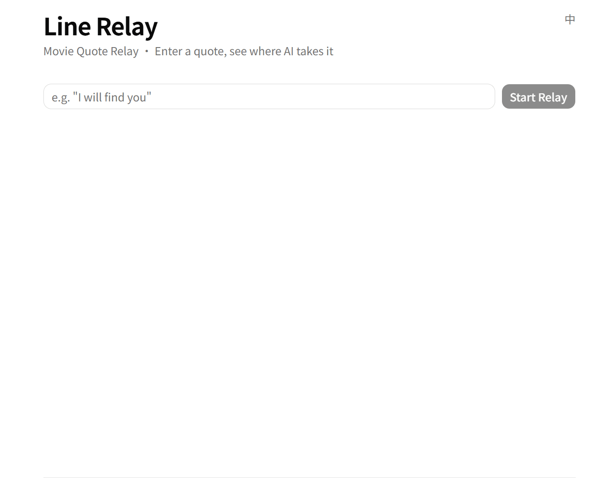

# Line Relay - AI Movie Quote Relay Generator | AI 电影台词接龙

[](https://github.com/KeitouYa/line-relay/actions/workflows/ci.yml)

Type one movie quote, and Line Relay builds a chain of quotes from different films, streamed to the page one line at a time. | 输入一句电影台词，系统从不同电影里接出一串台词，一句一句推送到页面上。

## Demo



Type any quote and get a 6-line relay across films: the closest match to your quote, then 5 rounds of keyword pivots, tonal twists and absurd jumps, picked by an LLM judge.

The live demo is offline (the server cost money every month). See the GIF above, or run it locally with **Quick Start** below. | 在线 Demo 已下线（服务器按月收费）。效果见上面的 GIF，也可以按"快速启动"在本地运行。

## How It Works | 工作原理

1. **Seed match | 匹配起始台词**: your input is matched with hybrid search. Postgres full-text search (`tsvector`) and pgvector cosine search run on it, and the two result lists are merged with Reciprocal Rank Fusion (RRF).
2. **Each round | 每一轮接龙**:
   - Candidates are pulled in parallel from 3 paths: semantic (pgvector), keyword (full-text) and random.
   - RRF merges them, and quotes from the same film as the previous line are dropped.
   - An LLM judge reads the top ~20 candidates and returns 3 picks as JSON. Each pick is tagged with a mode: `follow-up`, `keyword-trigger`, `twist` or `break`. One of the 3 is chosen at random so the same input doesn't always give the same chain.
   - If the LLM output can't be parsed, the round falls back to the RRF top-1.
3. **Streaming | 流式推送**: `GET /api/relay/stream` is a Server-Sent Events endpoint. It sends `seed`, then one `round` event per step, then `done`. `EventSource` can't read HTTP status codes, so the page first sends a probe request (`X-Relay-Probe: 1`). The probe only checks the rate limit and returns 204 or 429.
4. **Rate limiting | 限流**: three Redis limits: a global daily limit, a per-IP daily limit and a per-IP cooldown (defaults in `config.py`: 100 / 3 / 30 s, can be changed in `.env`). All three are checked and counted in one atomic Lua script, so only requests that are let through use up quota.

## Quick Start | 快速启动

```bash
# 1. Copy environment variables | 复制环境变量
cp .env.example .env
# Fill in at least OPENAI_API_KEY, DEEPSEEK_API_KEY, OPENSUBTITLES_API_KEY and ADMIN_TOKEN.
# Every key in .env.example must be present; placeholder values are fine for the ones you don't use.
# 至少填 OPENAI_API_KEY、DEEPSEEK_API_KEY、OPENSUBTITLES_API_KEY 和 ADMIN_TOKEN；其他用不到的 key 填占位值即可。

# 2. Start all services | 启动所有服务
docker compose up --build

# 3. First run only: create the tables, then import subtitles | 首次运行：建表，再导入台词
curl -X POST localhost:8001/admin/setup-db    -H "X-Admin-Token: <your ADMIN_TOKEN>"
curl -X POST localhost:8001/admin/import-data -H "X-Admin-Token: <your ADMIN_TOKEN>"
# The import downloads subtitles for ~20 films from OpenSubtitles and embeds every line (uses OpenAI credits).
# 导入会从 OpenSubtitles 下载约 20 部电影的字幕，并为每句台词生成 embedding（会消耗 OpenAI 额度）。

# 4. Open | 访问
# Frontend | 前端:          http://localhost:3000
# API docs | 后端 API 文档: http://localhost:8001/docs
# Health   | 健康检查:      http://localhost:8001/health
```

The backend listens on port 8000 inside its container and is mapped to **8001** on your machine. | 后端在容器里是 8000 端口，映射到本机的 **8001**。

## Tech Stack | 技术栈

- **Frontend | 前端**: Next.js 16 + React 19 + shadcn/ui + Tailwind CSS 4
- **Backend | 后端**: Python + FastAPI + SQLAlchemy
- **Database | 数据库**: PostgreSQL 16 + pgvector (1536-dim vectors) + Postgres full-text search
- **Rate limiting | 限流**: Redis 7
- **LLM**: DeepSeek V4 Flash by default, behind a pluggable LLM provider interface (switch models with `LLM_PROVIDER`)
- **Embedding**: OpenAI `text-embedding-3-small`
- **Subtitle data | 台词数据**: OpenSubtitles API
- **Containerization | 容器化**: Docker Compose
- **CI**: GitHub Actions (backend `pytest` + frontend build)

## Tests | 测试

```bash
# Unit and API tests | 单元测试和接口测试
docker compose exec backend pytest -v
```

Benchmark scripts are in [`backend/tests/benchmark/`](backend/tests/benchmark/). The method, raw data and how to rerun them are in [`REPORT.md`](backend/tests/benchmark/REPORT.md). Latest results, run on local Docker on 2026-10-22: | 最新结果（2026-10-22，本机 Docker）：

| Test | Result |
|---|---|
| 30 full 5-round relays with real DeepSeek | 30/30 succeeded, 0 LLM fallbacks in 150 rounds |
| Time to first round | mean 2.21 s, P95 2.87 s |
| Time to finish all 5 rounds | mean 9.89 s, P95 12.56 s |
| Rate limit: 20 and 50 concurrent requests, 4 workers | Allowed and rejected counts exactly match the limits; Redis counters equal the number of allowed requests |

## Fix Log | 修复记录

| Date | Problem | Fix | Verification |
|---|---|---|---|
| 2026-10-22 | Requests rejected by the rate limiter (429) still added to the Redis counters, so one IP sending requests quickly could use up the global daily quota for everyone. | All three limits are now checked and counted in one atomic Redis Lua script, and a request is counted only if it is let through. The unused slowapi limiter was removed. | 20 and 50 concurrent requests on 4 workers: the global counter went from 20 / 50 to 1 / 10, equal to the number of allowed requests. See [`REPORT.md`](backend/tests/benchmark/REPORT.md), section 5. |
| 2026-05-08 | Short inputs matched off-topic seeds. "I love you!" matched "...and this is for you!" (The Godfather Part II). | Seed matching changed from pgvector only to hybrid search: keyword + pgvector, merged with RRF. | Same query in the 2026-10-22 benchmark: pgvector-only still returns the Godfather line; hybrid returns "...that I'd fall in love with that man..." (The Matrix). |
